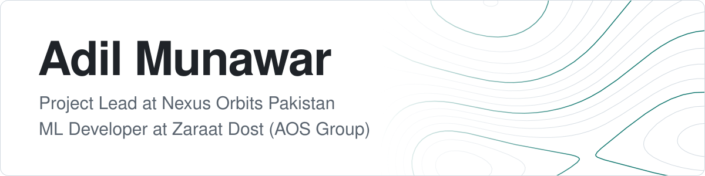

<picture>
  <source media="(prefers-color-scheme: dark)" srcset="assets/banner-dark.svg">
  <source media="(prefers-color-scheme: light)" srcset="assets/banner-light.svg">
  
</picture>

  <a href="https://adilmunawar.vercel.app">Portfolio</a>
  &nbsp;&middot;&nbsp;
  <a href="https://www.linkedin.com/in/adilmunawar">LinkedIn</a>

I am Project Lead at Nexus Orbits Pakistan and ML Developer at Zaraat Dost Private Limited, part of AOS Group. My work sits in three areas: geospatial machine learning, private cloud architecture, and multi tenant SaaS products.

## Featured: Argus

**[Argus](https://github.com/Adilmunawar/ARGUS)** is a blueprint for a sovereign private cloud: a complete design for moving workloads off AWS and onto owned hardware, for teams that need data residency, GPU capacity and operational control.

Every component is backed by a decision record that names the options rejected and what they cost, and a validation status page grades each claim as verified, grounded, reasoned or assumed, so the plan says plainly what is still unproven.

<table>
  <tr>
    <td><b>Decisions</b></td>
    <td>34 architecture decision records, a threat model, runbooks, and a hardware and licensing bill of materials</td>
  </tr>
  <tr>
    <td><b>Built so far</b></td>
    <td>Web console prototype with 15 screens, browser RDP and SSH, and 413 passing tests; a self hosted Docker Compose stack; a PowerShell module</td>
  </tr>
  <tr>
    <td><b>Platform</b></td>
    <td>Windows Server, Hyper V, Service Fabric, Active Directory, GitOps, zero trust</td>
  </tr>
  <tr>
    <td><b>Targets</b></td>
    <td>RPO 15 minutes, RTO 8 hours for full site loss, 99.9% availability</td>
  </tr>
  <tr>
    <td><b>Status</b></td>
    <td>Planning stage, v0.12.0. Published to read and discuss, all rights reserved</td>
  </tr>
</table>

## Selected projects

| Project | What it does | Built with |
| --- | --- | --- |
| **[QGIS MCP](https://github.com/Adilmunawar/QGIS_MCP)** | QGIS toolbox for open satellite, weather and elevation data, with a permission gated MCP server of 121 tools, an approval queue and an audit log, so AI agents can drive QGIS under human control | Python, PyQGIS, PyQt6, MCP |
| **[ZD Claude Plugin](https://github.com/Adilmunawar/ZD-claude-plugin)** | Claude Code plugin marketplace that packages a team's geospatial engineering rules into 15 modules, 44 commands, 14 agents and tested hooks. MIT licensed, v7.6.1 | JavaScript, Python, PowerShell |
| **[AdiCorp HR](https://github.com/Adilmunawar/AdiCorp)** ([live](https://adicorp.vercel.app)) | Multi tenant HR platform for attendance, leave, payroll, policies and hiring, with every business rule and permission enforced in the database | React, TypeScript, Supabase, PostgreSQL |
| **[AdiGaze](https://github.com/Adilmunawar/AdiGaze)** ([live](https://adigaze.vercel.app)) | Resume intelligence platform that turns uploaded resumes into structured candidate records, then matches and ranks them against hiring needs | TypeScript, Supabase Edge Functions, Gemini |
| **[AdiNox](https://github.com/Adilmunawar/AdiNox)** ([live](https://adinox.vercel.app)) | OTP authenticator and token manager with local persistence and Supabase authentication | React, TypeScript, Supabase |

**More:** [Satellite Imagery Deep Learning](https://github.com/Adilmunawar/Satelite-Imagery-Deep-Learning), a curated reference list of Earth observation models.

**Private:** AGIS, a geospatial intelligence platform for satellite analysis and field boundary detection. AdiARC, AI assisted modernization of legacy land records.

## Machine learning

Most of my model work is private to Zaraat Dost, so this section lists the architectures rather than repositories.

| Model | Task | Approach |
| --- | --- | --- |
| HRNet W48 encoder with U-Net | Boundary segmentation on 0.3 m imagery | Patch inference with Hanning window blending and hysteresis thresholding, then graph based vector straightening |
| Temporal attention U-Net | Crop mapping from Sentinel-2 | Segmentation over multi date image sequences |
| SAM 2 | Zero shot field boundaries | Tiled inference with seam stitching and cleanup |
| XGBoost | Land use classification | Twelve month spectral and vegetation index features per parcel |
| Isolation Forest | Data cleaning | Removes cloud, shadow and sensor anomalies before classification |
| Gemini | Document extraction and scoring | Resume parsing and candidate ranking in AdiGaze |

## Stack

  

| Area | Tools |
| --- | --- |
| Machine learning | PyTorch, timm, segmentation-models-pytorch, scikit-learn, XGBoost, OpenCV, Albumentations, Hugging Face Hub |
| Geospatial | QGIS, PyQGIS, Google Earth Engine, PostGIS, Rasterio, GeoPandas, Shapely |
| AI engineering | Model Context Protocol, Claude Code plugins, Gemini, Genkit |
| Backend and data | Python, FastAPI, Node.js, .NET, PostgreSQL, Supabase, Firebase |
| Frontend and mobile | TypeScript, React, Next.js, Vite, Tailwind CSS, shadcn/ui, TanStack Query, Expo |
| Infrastructure | Docker, GitHub Actions, Windows Server, Hyper V, PowerShell, Prometheus, Grafana, OpenBao, Vercel, AWS, Google Cloud, Azure |
